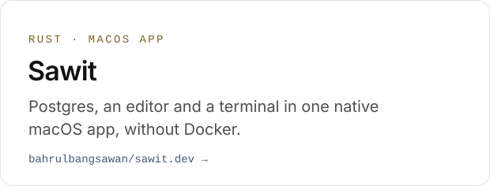

<a href="https://bahrul.me">
  <picture>
    <source media="(prefers-color-scheme: dark)" srcset="assets/hero-dark.svg">
    
  </picture>
</a>

  <a href="https://bahrul.me"><b>bahrul.me</b></a> ·
  <a href="https://bahrul.me/book">Book a call</a> ·
  <a href="mailto:project@bahrul.me">project@bahrul.me</a> ·
  <a href="https://linkedin.com/in/bahrulbangsawan">LinkedIn</a> ·
  <a href="https://x.com/work_bahrul">X</a> ·
  <a href="https://instagram.com/bahrulbangsawan">Instagram</a>

I'm a go-to-market engineer in Indonesia. I build websites and apps for businesses, automate their repetitive marketing work, and set up the data that shows what works. Along the way I build the developer tools I wish I had, and I open-source them here.

### Activity

  <picture><source media="(prefers-color-scheme: dark)" srcset="assets/stats-dark.svg"></picture>

  <picture><source media="(prefers-color-scheme: dark)" srcset="assets/contributions-dark.svg"></picture>

  <picture><source media="(prefers-color-scheme: dark)" srcset="assets/weekly-dark.svg"></picture>
  <picture><source media="(prefers-color-scheme: dark)" srcset="assets/languages-dark.svg"></picture>

### Tools I build

  <a href="https://github.com/bahrulbangsawan/sawit.dev"><picture><source media="(prefers-color-scheme: dark)" srcset="assets/card-sawit-dark.svg"></picture></a>
  <a href="https://github.com/bahrulbangsawan/claude-pool"><picture><source media="(prefers-color-scheme: dark)" srcset="assets/card-claude-pool-dark.svg"></picture></a>

  <a href="https://github.com/bahrulbangsawan/content-studio"><picture><source media="(prefers-color-scheme: dark)" srcset="assets/card-content-studio-dark.svg"></picture></a>
  <a href="https://github.com/bahrulbangsawan/manujujaya-mcp"><picture><source media="(prefers-color-scheme: dark)" srcset="assets/card-manujujaya-mcp-dark.svg"></picture></a>

### More public work

- **[Kalkulator MBG](https://github.com/bahrulbangsawan/kalkulatormbg)**: a real-time budget tracker for Indonesia's free school meals program.
- **[pilihpendidikan](https://github.com/bahrulbangsawan/pilihpendidikan)**: CV, invoice and portfolio builders that run in the browser and export print-ready PDFs.
- **[MidTest](https://github.com/bahrulbangsawan/midtest)**: a desktop agent for AI-powered app testing and walkthrough generation.
- **[invoice-gen](https://github.com/bahrulbangsawan/invoice-gen)**: an invoice generator with an AI assistant and PDF export.

### Where I work

- **[KYZN](https://kyzn.life)**, since 2022: marketing operations, funnel optimization and data infrastructure for a family wellness club.
- **[Growthacker](https://growthacker.id)**, co-founder since 2021: growth strategy, SEO and conversion work for business clients.

### What I build with

TypeScript · TanStack Start · React · Cloudflare Workers · Bun · PostgreSQL · Rust · Swift

  Have a project in mind? <a href="https://bahrul.me/book">Book a call</a> or write to <a href="mailto:project@bahrul.me">project@bahrul.me</a>.

