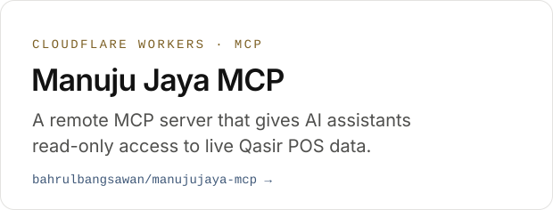

  <a href="https://bahrul.me"><picture><source media="(prefers-color-scheme: dark)" srcset="assets/hero-dark.svg"></picture></a>

  <a href="https://bahrul.me"><picture><source media="(prefers-color-scheme: dark)" srcset="assets/link-site-dark.svg"></picture></a>
  <a href="https://bahrul.me/book"><picture><source media="(prefers-color-scheme: dark)" srcset="assets/link-book-dark.svg"></picture></a>
  <a href="mailto:project@bahrul.me"><picture><source media="(prefers-color-scheme: dark)" srcset="assets/link-email-dark.svg"></picture></a>
  <a href="https://linkedin.com/in/bahrulbangsawan"><picture><source media="(prefers-color-scheme: dark)" srcset="assets/link-linkedin-dark.svg"></picture></a>
  <a href="https://x.com/work_bahrul"><picture><source media="(prefers-color-scheme: dark)" srcset="assets/link-x-dark.svg"></picture></a>
  <a href="https://instagram.com/bahrulbangsawan"><picture><source media="(prefers-color-scheme: dark)" srcset="assets/link-instagram-dark.svg"></picture></a>
  <a href="https://threads.net/@bahrulbangsawan"><picture><source media="(prefers-color-scheme: dark)" srcset="assets/link-threads-dark.svg"></picture></a>

I'm a go-to-market engineer in Indonesia. I build websites and apps for businesses, automate their repetitive marketing work, and set up the data that shows what works. Along the way I build the developer tools I wish I had, and I open-source them here.

### GitHub activity

  <picture><source media="(prefers-color-scheme: dark)" srcset="assets/stats-dark.svg"></picture>

  <picture><source media="(prefers-color-scheme: dark)" srcset="assets/contributions-dark.svg"></picture>

  <picture><source media="(prefers-color-scheme: dark)" srcset="assets/weekly-dark.svg"></picture>
  <picture><source media="(prefers-color-scheme: dark)" srcset="assets/weekdays-dark.svg"></picture>

  <picture><source media="(prefers-color-scheme: dark)" srcset="assets/monthly-dark.svg"></picture>
  <picture><source media="(prefers-color-scheme: dark)" srcset="assets/languages-dark.svg"></picture>

### Work

  <picture><source media="(prefers-color-scheme: dark)" srcset="assets/work-dark.svg"></picture>

  <picture><source media="(prefers-color-scheme: dark)" srcset="assets/career-dark.svg"></picture>

  <picture><source media="(prefers-color-scheme: dark)" srcset="assets/toolbox-dark.svg"></picture>

Currently at **[KYZN](https://kyzn.life)** and co-founder of **[Growthacker](https://growthacker.id)**. The full story, case studies and writing are on **[bahrul.me](https://bahrul.me)**.

### Tools I build

  <a href="https://github.com/bahrulbangsawan/sawit.dev"><picture><source media="(prefers-color-scheme: dark)" srcset="assets/card-sawit-dark.svg"></picture></a>
  <a href="https://github.com/bahrulbangsawan/claude-pool"><picture><source media="(prefers-color-scheme: dark)" srcset="assets/card-claude-pool-dark.svg"></picture></a>

  <a href="https://github.com/bahrulbangsawan/content-studio"><picture><source media="(prefers-color-scheme: dark)" srcset="assets/card-content-studio-dark.svg"></picture></a>
  <a href="https://github.com/bahrulbangsawan/manujujaya-mcp"><picture><source media="(prefers-color-scheme: dark)" srcset="assets/card-manujujaya-mcp-dark.svg"></picture></a>

### More public work

- **[Kalkulator MBG](https://github.com/bahrulbangsawan/kalkulatormbg)**: a real-time budget tracker for Indonesia's free school meals program.
- **[pilihpendidikan](https://github.com/bahrulbangsawan/pilihpendidikan)**: CV, invoice and portfolio builders that run in the browser and export print-ready PDFs.
- **[MidTest](https://github.com/bahrulbangsawan/midtest)**: a desktop agent for AI-powered app testing and walkthrough generation.
- **[invoice-gen](https://github.com/bahrulbangsawan/invoice-gen)**: an invoice generator with an AI assistant and PDF export.

  Every number and chart on this page is rebuilt daily from the GitHub API and <a href="https://bahrul.me/developers">bahrul.me's public API</a>.

